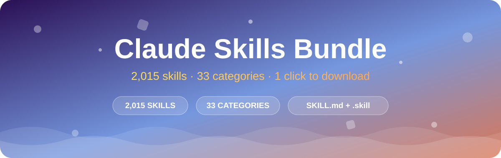
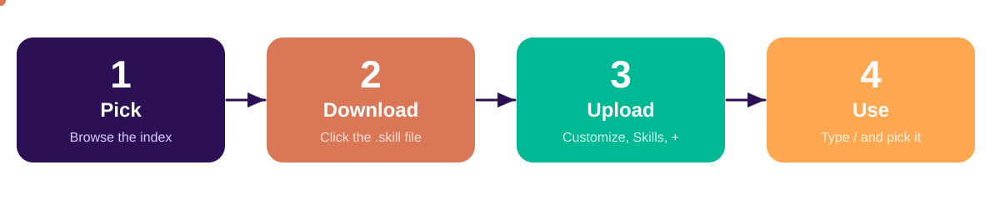
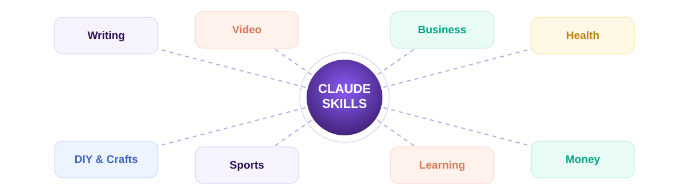

<div align="center">




### 2,015 ready-to-use skills for Claude — pick one, download it, upload it. Done.

</div>


## ⚡ Get a skill in 3 clicks



1. **Find it** — browse the [skills index](skills-index.md) or open a category folder below
2. **Download it** — open the skill folder and click its **`.skill`** file, then **Download**
3. **Upload it** — on [claude.ai](https://claude.ai): **Customize → Skills → + → Create skill** → upload the `.skill` file → turn it **on**

Then start a new chat, type `/` and pick your skill.

> **Prefer Google Drive?** Every skill is also on Drive — click **🔗 Drive** next to any skill in the [skills index](skills-index.md), or browse the whole bundle in the [Google Drive folder](https://drive.google.com/drive/folders/1DxSqI_rJDa22_9beJzyEim4rqngUfIG-).


> **Two files in every skill folder:** `SKILL.md` to *read* what the skill does, and
> `name.skill` to *download and upload* to Claude. Same skill, no re-zipping needed.


## 🗂️ What's inside



| Category | Skills | Category | Skills |
|---|---:|---|---:|
| 🤖 [ai-automation-and-agents](skills-index.md#ai-automation-and-agents) | 13 | 💼 [career-and-jobs](skills-index.md#career-and-jobs) | 47 |
| ✍️ [content-writing](skills-index.md#content-writing) | 50 | 🖊️ [copywriting](skills-index.md#copywriting) | 9 |
| 📖 [creative-and-storytelling](skills-index.md#creative-and-storytelling) | 14 | 📚 [creative-fiction](skills-index.md#creative-fiction) | 50 |
| 🎨 [design-and-visual](skills-index.md#design-and-visual) | 51 | 🛠️ [DIY](skills-index.md#diy) | 348 |
| 🎓 [education-and-teaching](skills-index.md#education-and-teaching) | 49 | 📧 [email-marketing](skills-index.md#email-marketing) | 50 |
| 🚀 [entrepreneurship](skills-index.md#entrepreneurship) | 48 | 📊 [Excel](skills-index.md#excel) | 100 |
| 🏠 [family-and-home](skills-index.md#family-and-home) | 49 | 💰 [finance-and-money](skills-index.md#finance-and-money) | 49 |
| 🏋️ [health-and-fitness](skills-index.md#health-and-fitness) | 50 | 🎭 [hobbies-and-crafts](skills-index.md#hobbies-and-crafts) | 50 |
| 😂 [humor-and-entertainment](skills-index.md#humor-and-entertainment) | 49 | ⚖️ [legal-writing](skills-index.md#legal-writing) | 51 |
| 📣 [marketing-and-branding](skills-index.md#marketing-and-branding) | 61 | 🤝 [nonprofit-and-social](skills-index.md#nonprofit-and-social) | 10 |
| 🌱 [personal-growth](skills-index.md#personal-growth) | 38 | 🎙️ [podcasting](skills-index.md#podcasting) | 10 |
| ✅ [productivity-and-planning](skills-index.md#productivity-and-planning) | 49 | 🔍 [research-and-analysis](skills-index.md#research-and-analysis) | 48 |
| 💬 [sales-and-persuasion](skills-index.md#sales-and-persuasion) | 47 | 📱 [social-media](skills-index.md#social-media) | 46 |
| ⚽ [Sports](skills-index.md#sports) | 384 | ✈️ [travel-and-adventure](skills-index.md#travel-and-adventure) | 43 |
| 🧳 [travel-and-lifestyle](skills-index.md#travel-and-lifestyle) | 10 | 🎬 [Video Editing](skills-index.md#video-editing) | 97 |
| 💻 [web-and-app-development](skills-index.md#web-and-app-development) | 10 | 👔 [work-and-career](skills-index.md#work-and-career) | 23 |
| 📝 [writing-and-content](skills-index.md#writing-and-content) | 12 | | |

Full list with one-line descriptions: **[skills-index.md](skills-index.md)**

Nested groups live inside their parent — `Video Editing` splits into CapCut, Premiere Pro,
Final Cut Pro, DaVinci Resolve and After Effects; `DIY` into 35 crafts; `Excel` into
10 workbooks; `Sports` into 39 sports.


## 🧠 What is a skill?

A `.skill` file is a plain-text instruction set that guides Claude's behaviour when you
upload it to a conversation or project. It is not software, an app or a plugin — it does
not run on its own. Every skill here is one `SKILL.md`: a short `name` + `description`
header, then step-by-step instructions Claude follows.

**Example — `story-plot-fixer`:**

> *Diagnoses plot problems in novels, screenplays, and short stories and suggests
> specific structural fixes. Use this skill when you say "my plot has a problem",
> "my story feels stuck", or "help me restructure my story".*

## 🖥️ Use a skill in Claude Code too

Copy any skill folder straight into `.claude/skills/` — no zipping needed:

```bash
cp -r skills/creative-fiction/story-plot-fixer ~/.claude/skills/
```

Full illustrated guide: [`docs/How-to-Use-Claude-Skills.pdf`](docs/How-to-Use-Claude-Skills.pdf)

## 📁 Repo layout

```
claude-skills-bundle/
├── README.md
├── assets/                        # animated SVG artwork for this page
├── DISCLAIMER.md / NOTICE.md      # rights + disclaimer, read before sharing
├── docs/                          # the bundle's own PDFs, verbatim
├── skills/
│   ├── creative-fiction/story-plot-fixer/
│   │   ├── SKILL.md               # read it
│   │   └── story-plot-fixer.skill # download + upload it
│   ├── health-and-fitness/...
│   └── ... 2,015 skills in 33 categories
├── skills-index.md                # every skill, with descriptions + download links
└── scripts/                       # download-and-extract build scripts
```

## ⚠️ Important — read this

- The skills are reproduced **verbatim** from the purchased bundle — nothing was reworded.
- The bundle's disclaimer ships as-is in [`DISCLAIMER.md`](DISCLAIMER.md). Skills in
  health, legal, financial, career and medical categories are **informational only** —
  not a substitute for licensed professional advice.
- **No open-source license is claimed for the skills.** The bundle shipped with no
  redistribution license, so there is no LICENSE file here. See [`NOTICE.md`](NOTICE.md).
- Not affiliated with Anthropic.


